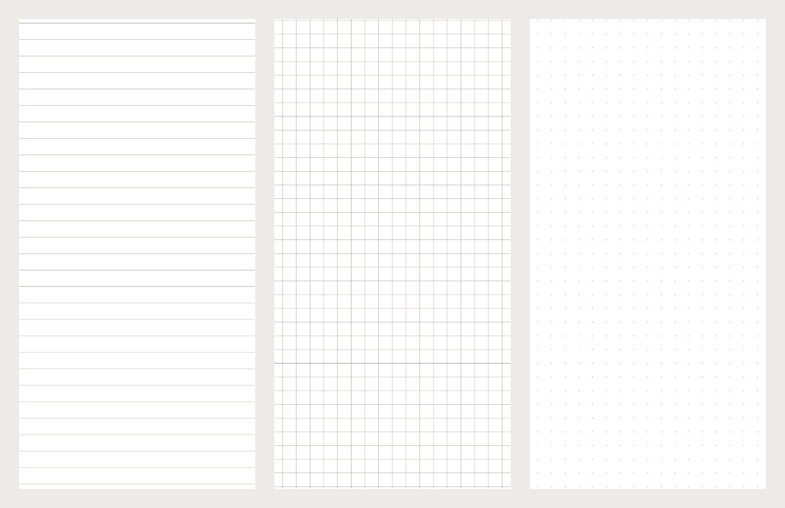

# Diary Note Generator

[한국어](README.md) | **English**

A browser-based editor for system-diary note refills — **lined, grid, and dot** — that saves them as print-ready PDFs. No install needed.

**Open it:** https://mov-ie.github.io/diary-note-generator/

## Patterns

Pick one of three patterns on the same page.

- **Lined:** horizontal rules in solid, dashed, or dotted style, with an optional vertical margin line.
- **Grid:** square grid with an optional heavier line every N squares.
- **Dot:** dot grid with adjustable dot size.

The default size is 86×171mm. A5, A4, or any custom size also works.

## Features

- **Spacing:** remembered separately for each pattern (defaults: lines 6mm, squares 5mm, dots 5mm).
- **Fill page:** when there is no header, the pattern runs edge to edge with no margins. Turn it off to keep the pattern inside the margins.
- **Pattern position:** where the leftover length (when the area isn't an exact multiple of the spacing) goes.
  - **Center:** split evenly on both sides. When filling the page, a line (or dot) sits exactly at the page center.
  - **Top:** start right at the top/left margin and leave the rest at the bottom/right.
- **Header:** a writing spot for the date (`date`) or number and date (`no.` / `date`) at the top. Labels are editable.
- **Page numbers:** placed in the bottom corner away from the ring, with a custom starting number.
- **Color and lines:** line/dot color (default dark brown #5B4636), opacity, line weight, text color. The line weight carries through to the printout.
- **Size and margins:** paper size (A5, A4, custom; default 86×171mm), ring-side / outer / top / bottom margins, page count.
- **Print layout:** save at refill size, or place several pages on A4 or A5 with crop marks. Single- or double-sided; on back pages (even pages) the ring margin switches sides.

## How to use

1. Open the page.
2. At the top of the left panel, pick **Lined / Grid / Dot**.
3. Adjust spacing, color, header, and margins. The preview updates immediately.
4. Choose the **page count** and **output paper**.
   - **Refill size:** one page per PDF page at actual size.
   - **A4 / A5:** several pages per sheet. Three 86×171mm pages fit on landscape A4, one on A5.
5. Click **PDF로 저장 / 인쇄** (Save PDF / Print) and choose **Save as PDF** in the print dialog.

Settings are kept in your browser. Use **처음 설정으로 되돌리기** (Reset) to go back to the defaults. The ring-position marking in the preview (light band, dashed lines, outlined holes in the 6-ring bible layout) is screen-only and never prints.

## Printing tips

- Set scale to **100% (actual size)** and margins to **None**, and turn off **headers and footers**.
- If the paper size isn't picked up automatically, open the page in **Chrome**.
- For double-sided printing, use **flip on long edge** for portrait layouts and **flip on short edge** for landscape layouts. The panel shows which one to use.
- Most printers can't print the outer 3–5mm. Enter that value as the **printer safe margin** so nothing gets cut off. For full-bleed refills, printing on A4 and trimming along the crop marks (which run from each page boundary to the paper edge) gives the cleanest edges.

## Related tools

- [Habit Tracker Generator](https://mov-ie.github.io/habit-tracker-generator/): habit tracker refills in the same style.
- [Monthly Generator](https://mov-ie.github.io/monthly-generator/): monthly refills and large A4 calendars.
- [Sudoku Generator](https://mov-ie.github.io/sudoku-generator/): sudoku refills.
