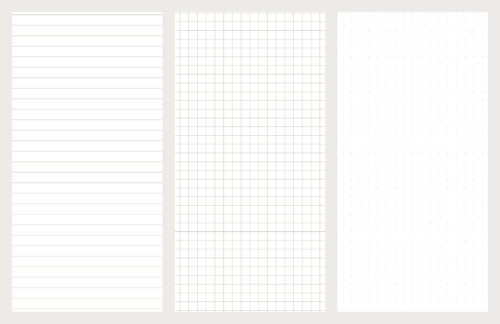

# Diary Note Generator

**한국어** | [English](README.en.md)

시스템 다이어리용 노트 속지(줄, 스퀘어, 도트)를 만들어 PDF로 저장하는 편집 도구예요. 설치 없이 브라우저에서 바로 써요.

**바로 쓰기:** https://mov-ie.github.io/diary-note-generator/

## 어떤 속지인가요

한 사이트에서 세 가지 패턴을 골라 만들어요.

- **줄 (lined):** 가로줄 노트. 실선, 파선, 점선 중에서 고르고, 세로 기준선을 넣을 수 있어요.
- **스퀘어 (grid):** 모눈 노트. 몇 칸마다 진한 선을 넣을 수 있어요.
- **도트 (dot):** 점 노트. 점 크기를 조절해요.

기본 크기는 86×171mm이고, A5·A4나 원하는 크기로도 만들 수 있어요.

## 할 수 있는 것

- **간격:** 패턴마다 따로 기억해요(기본값: 줄 6mm, 칸 5mm, 점 5mm).
- **페이지 꽉 채우기:** 머리 칸이 없을 때 패턴을 여백 없이 속지 끝까지 그려요. 끄면 여백 안에만 그려요.
- **패턴 자리:** 칸 크기로 나누어떨어지지 않고 남는 길이를 어디에 둘지 골라요.
  - **가운데:** 남는 길이를 양쪽에 반씩 나눠요. 꽉 채울 때는 속지 한가운데에 선(점)이 오게 맞춰요.
  - **위에 붙임:** 위쪽·왼쪽 여백에서 바로 시작하고, 남는 길이는 아래·오른쪽으로 가요.
- **머리 칸:** 맨 위에 날짜(date) 또는 번호+날짜(no. / date)를 적는 자리를 만들어요. 글자는 바꿀 수 있어요.
- **쪽 번호:** 링 반대쪽 아래 모서리에 들어가요. 시작 번호를 정할 수 있어요.
- **색과 선:** 선·점 색(기본 다크 브라운 #5B4636), 진하기, 선 굵기, 글자 색.
- **폰트:** 기본은 Open Sans예요. PC에 설치된 다른 폰트도 이름을 적어 쓸 수 있어요.
- **크기와 여백:** 규격(A5, A4, 직접 입력, 기본 86×171mm), 링 쪽·반대쪽·위·아래 여백, 쪽 수.
- **출력 배치:** 속지 크기 그대로 저장하거나, A4·A3 한 장에 여러 쪽을 재단선과 함께 배치해요. 단면과 양면을 고를 수 있어요. 양면이면 뒷면(짝수 쪽)은 링 쪽 여백이 반대편으로 가요.

## 사용법

1. 페이지를 열어요.
2. 왼쪽 패널 맨 위에서 **줄 / 스퀘어 / 도트** 중 하나를 눌러요.
3. 간격, 색, 머리 칸, 여백을 원하는 대로 바꾸세요. 오른쪽 미리보기가 바로 바뀌어요.
4. **쪽 수**와 **출력 용지**를 고르세요.
   - **속지 크기:** 실제 크기로 한 쪽씩 저장해요.
   - **A4 / A3:** 한 장에 여러 쪽을 배치해요. 86×171mm는 A4 가로에 3쪽이 들어가요.
5. 맨 아래 **PDF로 저장 / 인쇄**를 누르고, 인쇄 창에서 **PDF로 저장**을 고르세요.

설정은 브라우저에 저장돼서 다음에 열어도 그대로예요. 처음 상태로 돌리려면 **처음 설정으로 되돌리기**를 누르세요. 미리보기의 링 위치 표시(옅은 띠)는 화면에서만 보이고 인쇄되지 않아요.

## 프린트 팁

**인쇄 창 설정**
- 배율은 **100% (실제 크기)**로 두세요. "용지에 맞추기"가 켜져 있으면 속지가 줄어들어요.
- 여백은 **없음**으로 하세요.
- **머리글과 바닥글**을 끄세요.
- 용지 크기가 자동으로 잡히지 않으면 **Chrome**으로 열어 보세요.

**양면 인쇄**
- 세로 배치는 **긴 쪽 넘기기**, 가로 배치는 **짧은 쪽 넘기기**로 출력하세요. 패널에도 안내가 나와요.

**재단과 용지**
- 한 장만 먼저 뽑아서 자로 크기를 재 보세요.
- 재단선을 켜면 각 쪽 모서리 바깥에 자를 위치가 표시돼요.
- 프린터는 보통 가장자리 3~5mm를 못 찍어요. **프린터 안전 여백**에 그 값을 넣어 두면 잘리지 않게 배치해요. 꽉 채운 속지를 속지 크기로 뽑을 때도 가장자리가 조금 비어 나올 수 있으니, A4에 배치해 재단하는 걸 추천해요.

## 같이 쓰면 좋은 도구

- [Habit Tracker Generator](https://mov-ie.github.io/habit-tracker-generator/): 같은 스타일의 해빗트래커 속지.
- [Monthly Generator](https://mov-ie.github.io/monthly-generator/): 같은 스타일의 먼슬리 속지와 A4 큰 달력.
- [Sudoku Generator](https://mov-ie.github.io/sudoku-generator/): 같은 스타일의 스도쿠 속지.

## 폰트

Open Sans와 Jost가 페이지 안에 들어 있어요. 두 폰트 모두 SIL Open Font License 1.1을 따라요([OFL.txt](OFL.txt)).
